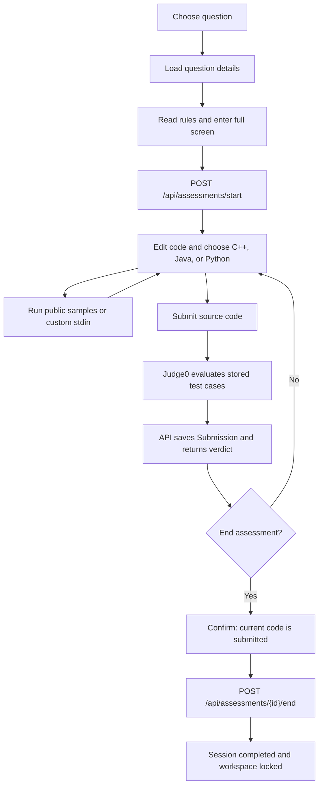

# Assessment and Practice Engine

Practice selection and question lookup happen in the browser; assessment state and submissions are recorded by Next.js API handlers in PostgreSQL.

## Practice modes

### Random Practice

The `/practice` page fetches the complete `GET /api/questions` list once, then builds topic choices from those results. The user selects a topic and difficulty (or “Any”). The browser filters the in-memory list and selects one matching question using `Math.floor(Math.random() * matchingQuestions.length)`, then navigates to `/questions/{id}`.

This is client-side random selection, not a random API. No matches show an error instead of starting.

### Specific Practice

The question library also loads `GET /api/questions`; its local controls filter by text, number/title/topic, difficulty, topic, attempted/not-attempted/solved status, and sort order. Selecting a result opens `/questions/{id}`. The workspace fetches `GET /api/questions/{id}` to load the problem, public samples, hints, constraints, and (for admins only) hidden test cases/reference solutions.

## Assessment lifecycle

The question workspace first loads settings from `GET /api/assessments/start`. The rules gate requires the user to confirm the rules and enter browser full screen before `POST /api/assessments/start` creates a `Session`. Mode and duration come from server configuration (`ASSESSMENT_MODE`, `ASSESSMENT_DURATION_MINUTES`); the client cannot choose them.

The header displays elapsed time and can switch to remaining time. It is a client-side display: the inspected end/submission handlers do not enforce an elapsed-time deadline or automatically close/submit a session. The user ends a session through the confirmation flow. Confirmation submits the current code, then calls the end endpoint; the API requires at least one saved submission. On success it sets `completedAt`, shows results, and locks the workspace. A terminated or completed assessment cannot accept another submission when its `assessmentId` is supplied.

## Run, submit, and progress

- **Run** calls `POST /api/run`. With a question, this runs up to 20 public samples; a custom run uses supplied stdin. Runs are not persisted as `Submission` records.
- **Submit** calls `POST /api/submit` with the question ID, active assessment ID, language, and code. The backend evaluates up to 100 stored test cases and creates a `Submission`.
- The response contains an overall status, counts, per-case verdicts, and sample details; hidden input/output are omitted. After an accepted submission, `GET /api/questions` derives `progress.solved` from the user's saved accepted submissions. Profile stats also count accepted questions.
- Ending the assessment requires a submission; an incorrect result can still be submitted and used to finish the session.

The API endpoint details and error responses are in the [API Reference](./api-reference.md). Assessment monitoring behavior is covered in [Secure Assessment and Violation Detection](./secure-assessment-violations.md).
