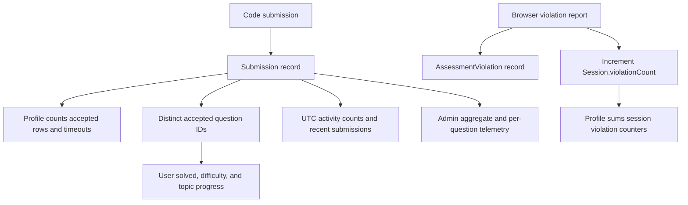

# Dashboard and Progress Tracking

OA Duck has an aggregate Admin Dashboard at `/admin` and a personal profile dashboard at `/profile`. They use different data paths and expose different scopes of analytics.

## Admin Dashboard

The server-rendered page at `/admin` checks for the `ADMIN` role, then loads users, questions, all submissions with a question ID, and the total session count directly through Prisma. These datasets are passed to `src/app/admin/AdminDashboard.jsx`; there is no separate dashboard API endpoint.

| Metric or view | Calculation and source | Refresh |
|---|---|---|
| Registered Accounts | `User` row count in the loaded users list | When the page is requested again |
| Problem Bank | Number of loaded `Question` records | When the page is requested again |
| Practice Sessions | Count of all `Session` records, including completed and ongoing sessions | When the page is requested again |
| Submission Attempts | Count of loaded `Submission` rows with a non-null `questionId`, optionally filtered by the selected range | Range selection filters the page's already-loaded rows |
| Questions by Topic | Number of question-topic assignments; questions with no topics are labeled `Uncategorized` | Calculated in the browser from the loaded questions |
| Questions by Difficulty | Question counts grouped by the question's difficulty value | Calculated in the browser from the loaded questions |
| Average attempts per tracked problem | Submission count in the selected range divided by the total question count; displayed to one decimal place | Calculated in the browser |
| Per-question attempts | Number of loaded submission rows for that question; this column is labeled “Avg Attempts” in the table but displays the raw count | Calculated in the browser |
| Per-question acceptance rate | Accepted rows divided by all rows for that question | Calculated in the browser |
| Per-question total solves | Distinct non-null submitting users with accepted submissions; if there are no such user IDs, accepted-row count is used | Calculated in the browser |
| Overall acceptance rate | Accepted rows divided by the selected submission count | Calculated in the browser |

The accepted-status helper recognizes `accepted`, `success`, `passed`, and `solved`, case-insensitively. Admin telemetry is aggregate and question-oriented. The separate user-management page lists account identity and role and supports role changes/deletion; it does **not** show per-user performance. The admin dashboard also does **not** currently display violation totals or a separate correct-submission count card.

The 7-day and 30-day controls filter against a reference timestamp taken from the newest submission loaded by the server, rather than the current time. Per-question attempt and acceptance columns are calculated from the full submission data and are not recalculated for that selected range.

## User Dashboard

`/profile` fetches the authenticated user's `GET /api/profile/stats` endpoint. The API scopes queries to the signed-in user's database ID and returns profile data and the `stats` object.

| Metric or view | Calculation and source | When it changes |
|---|---|---|
| Total solved | Distinct question IDs with at least one accepted submission; submissions without a question ID are excluded | On the next stats fetch after an accepted submission |
| Completion percent | Rounded `distinct solved / total question rows * 100`; zero when there are no questions | On the next stats fetch |
| Difficulty progress | Distinct accepted questions grouped into Easy, Medium, and Hard; denominator is all question rows in each difficulty | On the next stats fetch after submission or question-bank changes |
| Solved by topic | Distinct accepted questions counted once for each assigned topic; missing topics appear under `Uncategorized` | On the next stats fetch |
| Accepted | Count of all accepted submission rows, not distinct questions | On the next stats fetch after a submission |
| Timeouts (TLE) | Submission rows whose status text contains `time limit` or `timeout`, case-insensitively | On the next stats fetch |
| Violations | Sum of `Session.violationCount` across the user's sessions; it is a session counter, not a count of individual `AssessmentViolation` rows | After a violation is recorded and the dashboard is fetched again |
| Give Ups | Completed sessions that have no accepted submission associated with that session | After a session is completed and stats are fetched |
| Activity heatmap | Submission count by UTC date for the last 365 days; `totalSubmissions` is for that same period | After a new submission and the next stats fetch |
| Active days | Number of distinct UTC dates with at least one submission in that one-year window | After a new submission and the next stats fetch |
| Current and longest streak | Consecutive UTC submission dates within the one-year window; the current streak may continue from yesterday if there was no submission today | After a new submission and the next stats fetch |
| Recent Activity | The six most recent submission records, with status, language, timestamp, and question summary | On the next stats fetch |

An accepted submission and a solved question are different quantities: multiple accepted submissions for one question increment **Accepted** multiple times but add only one question to **Total solved**. The personal dashboard does not provide a distinct-question attempted count or a list of assessment sessions; its recent activity is a submission list.

## How records feed the metrics

The admin page computes its metrics from the records loaded on each request. The profile metrics are computed by `GET /api/profile/stats`; the page does not keep a live subscription, so a refresh or a new fetch is required to see subsequent changes.
