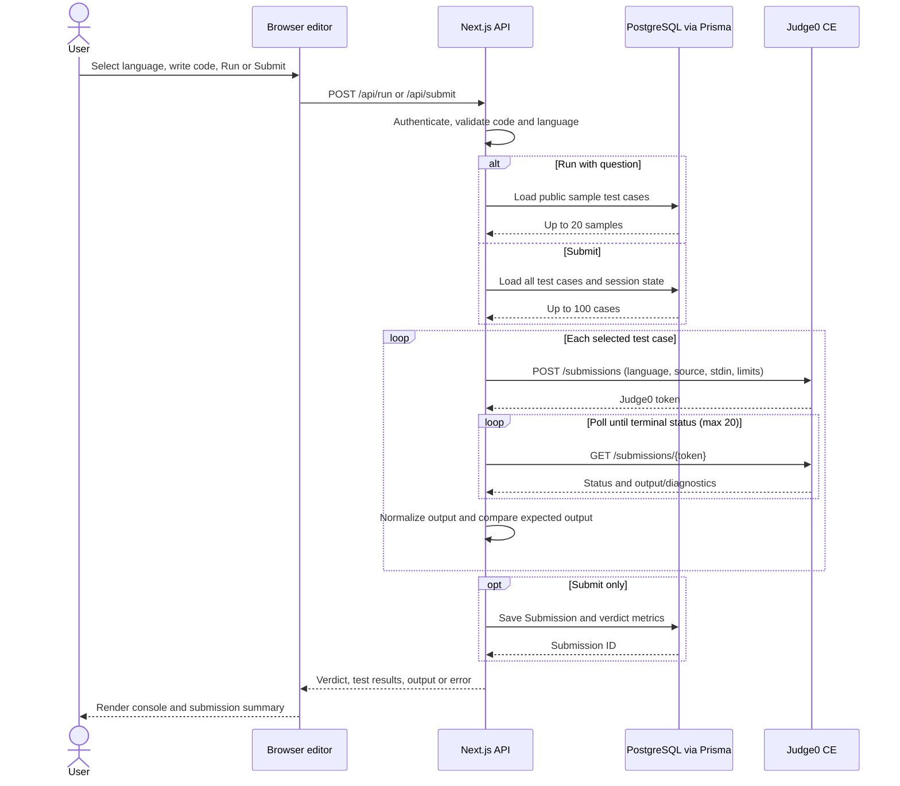

# Judge0 Code Execution Integration

OA Duck sends untrusted source code to Judge0 CE rather than executing it in the Next.js server process. The integration is in `src/lib/judge0.js`; authenticated Next.js handlers select test input, poll Judge0, compare output, and persist submissions.

## Languages and verdicts

| UI language | API value | Judge0 language ID |
|---|---|---:|
| C++ | `cpp` | 54 |
| Java | `java` | 62 |
| Python | `python` | 71 |

`normalizeResult` maps Judge0 status IDs as follows:

| Judge0 status ID | OA Duck verdict |
|---|---|
| 3 | `Accepted` |
| 4 | `Wrong Answer` |
| 5 | `Time Limit Exceeded` |
| 6 | `Compilation Error` |
| 7–12 | `Runtime Error` |
| 13 | `Internal Error` |
| Other / not terminal yet | `Processing` |

For sample and full submissions, a process result with status 3 whose normalized stdout differs from expected output is changed to `Wrong Answer`. A submission is `Accepted` only when every evaluated test passes. Otherwise it uses the first failing test's normalized verdict. Judge0 statuses not explicitly mapped above are not given a more specific OA Duck verdict.

## Execution and evaluation

1. The editor provides the selected language value and source code to `POST /api/run` or `POST /api/submit`. Supported languages are checked server-side; code is capped at 50,000 characters.
2. The backend calls Judge0 `POST /submissions` with `language_id`, `source_code`, and `stdin`. Public sample runs execute at most 20 sample cases. Submission evaluates all stored sample and hidden cases up to 100 total; a problem must have at least one hidden test case.
3. Each test case is run sequentially with a 2-second CPU limit. Direct/custom stdin execution uses the helper's default 5-second CPU limit. `normalizeStdin` strips one matching pair of outer quotes when present.
4. Judge0 returns a `token` when the asynchronous submission is accepted. OA Duck polls `GET /submissions/{token}` until the returned `status.id` is greater than 2 (finished), for up to 20 polls at 500 ms intervals. This token is issued by Judge0; OA Duck does not generate it.
5. The backend compares status and output. Output normalization converts CRLF to LF, trims ends, and collapses whitespace runs before comparison.
6. `/api/run` returns execution output and per-sample pass flags but does not save a `Submission`. `/api/submit` saves the status, code, test counts, runtime/memory when available, and failure details, then returns the overall verdict and per-case results.
7. `GET /api/questions` calculates a user's attempts and solved flag from saved submissions. An accepted submission therefore updates question-list progress after the next fetch.

Run results display stdout and available stderr/compiler output/message in the editor console. Submission results display test verdicts and sample output; hidden input/output remain hidden, though the response may include the first hidden-case diagnostic. A request/Judge0 failure returns an API error; the Run UI displays the error text. The Submit UI marks the submission as failed, while its current catch handler does not display the returned error text in the output panel.

## Judge0 HTTP contract

Create request (headers include `Content-Type: application/json`; `X-Auth-Token` is included only when configured):

```http
POST {JUDGE0_API_URL}/submissions?base64_encoded=false&wait=false
```

```json
{
  "language_id": 71,
  "source_code": "print(input())",
  "stdin": "hello\n",
  "cpu_time_limit": 2,
  "wall_time_limit": 8
}
```

The values above illustrate a Python test-case call; `wall_time_limit` is `max(cpu_time_limit + 2, 8)`. An accepted create response supplies a Judge0 `token`, for example `{ "token": "<judge0-submission-token>" }`.

Poll request:

```http
GET {JUDGE0_API_URL}/submissions/{token}?base64_encoded=false
```

The code consumes fields including `status.id`, `status.description`, `stdout`, `stderr`, `compile_output`, `message`, `time`, `memory`, and `exit_code`. A normalized OA Duck result has this shape:

```json
{
  "status": "Accepted",
  "statusId": 3,
  "verdict": "Accepted",
  "stdout": "hello\n",
  "stderr": "",
  "compileOutput": "",
  "message": "",
  "time": "0.01",
  "memory": 1024,
  "exitCode": 0
}
```

Judge0 fields such as output, runtime, and memory may be empty or null depending on the result.

## Configuration

| Variable | Behavior |
|---|---|
| `JUDGE0_API_URL` | Server-side Judge0 base URL. Defaults to `https://ce.judge0.com`; a trailing slash is removed. |
| `JUDGE0_AUTH_TOKEN` | Optional server-side token sent as `X-Auth-Token`. |

The backend sends `base64_encoded=false` and uses asynchronous `wait=false` submissions. Create/poll HTTP errors are raised and surfaced through the app API's failure response. If polling still has no terminal status after 20 attempts, the helper synthesizes status ID 13 (`Internal Error`) with a timeout diagnostic; this is not reported as Judge0's `Time Limit Exceeded`.

## Sequence diagram


